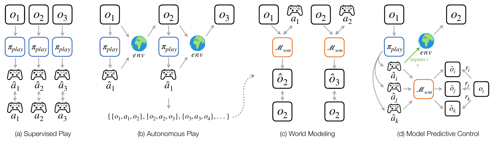

# Dexterity from Supervised Play (DSP) — simulation release

Code, checkpoints and data for the simulated **any-to-any in-hand cube reorientation** task of
*Dexterity from Supervised Play*: a 22-DoF Sharpa hand in Isaac Lab, a goal-free play policy
learned from a few minutes of Manus-glove teleoperation, hours of autonomous play collected by
that policy, an action-conditioned world model trained on the play data, and model-predictive
control that uses the play policy as its proposal distribution.



| | what you get | entry point |
|---|---|---|
| **1. Quick start** | the paper's simulation checkpoints (play policy + world model) and scripts that validate the full inference pipeline: one offline MPC replan (~1 min, no simulator) and closed-loop reorientation in Isaac Lab | [`quickstart/`](quickstart/README.md) |
| **2. Dataset** | the paper's human teleoperation takes + **5 h of autonomous play** collected by the paper's play policy, ready to train a play policy and a world model | [`docs/DATASET.md`](docs/DATASET.md) |
| **3. Pipeline** | the full simulation pipeline: Manus-glove teleoperation → play policy → autonomous self-play → world model → MPC, one resumable command | [`scripts/pipeline.sh`](scripts/pipeline.sh), [`docs/PIPELINE.md`](docs/PIPELINE.md) |

## Install

One conda env with Isaac Sim 5.1 + Isaac Lab 2.3.2 (Python 3.11) and `pip install -r
requirements.txt` — see [docs/INSTALL.md](docs/INSTALL.md). Training and the offline check
need only PyTorch.

## 1. Quick start: validate play policy + world model + MPC

The checkpoints and the dataset are assets of this repository's [v1.0 release](https://github.com/FAR-hands/play_policy/releases/tag/v1.0); the download
scripts below fetch them and verify their sha256.

```bash
bash quickstart/download_checkpoints.sh      # -> checkpoints/dsp_sim_{play_policy,world_model}.pt
python quickstart/check_inference.py         # one MPC replan, compared against reference values
bash quickstart/run_sim_mpc.sh               # closed-loop MPC in Isaac Lab, 8 trials (~4 min)
bash quickstart/run_sim_mpc.sh --full        # the paper's 128-trial evaluation (~45 min, RTX 5090)
bash quickstart/run_sim_mpc.sh --full --baseline   # same trials, play policy alone (~3 min)
```

Paper numbers for the released checkpoints (128 trials, random start and goal orientations at
least 90° apart, 2,500 control frames, dropped cubes respawn). On an RTX 5090 with Isaac Sim 5.1
and torch 2.7.0+cu128, `--full` and `--full --baseline` reproduce the published runs
bit-for-bit, trial by trial; on other hardware the chaotic contact dynamics make individual
trials diverge, so expect the totals to move by a few points:

| metric | released play policy alone (goal-blind) | **play policy + world model + MPC** |
|---|---|---|
| SR@0.4 / 0.6 / 0.8 rad (best error within the trial) | 32.8 / 53.9 / 72.7 % | **72.7 / 91.4 / 96.1 %** |
| reach within 30° | 46.9 % | **87.5 %** |
| mean best error | 34.7° | **17.3°** |

Details, expected outputs and timings: [quickstart/README.md](quickstart/README.md).

## 2. Dataset

```bash
bash scripts/download_dataset.sh             # -> data/dsp_sim_dataset/{teleop,play}
python -m play_policy.train            --data_dir data/dsp_sim_dataset/teleop   # play policy
python -m play_policy.train_worldmodel --data_dir data/dsp_sim_dataset/play     # world model
# or: world model on the 5 h + 128-trial MPC with the paper's play policy, in one command
POLICY_CKPT=checkpoints/dsp_sim_play_policy.pt PLAY_DATA=data/dsp_sim_dataset/play bash scripts/pipeline.sh
```

`teleop/` holds the 2 human glove takes (29,474 frames) that trained the paper's play policy;
`play/` holds 5.0 h (60 Hz label time, 1,081,500 frames, 206 episodes) of autonomous play by
that policy. `play/paper/` (128 episodes, 672,000 frames) is byte-for-byte the corpus that
trained the paper's world model; `play/extension/` continues the same seeded collection. Schema,
statistics and conventions: [docs/DATASET.md](docs/DATASET.md).

## 3. Full pipeline

```bash
# (a) record your own play with a Manus glove (optional -- the released takes work too)
bash scripts/teleop.sh --no-sim-panel                 # takes -> data/teleop_takes/, see docs/TELEOP.md
# (b) policy -> self-play -> world model -> MPC, resumable
HUMAN_DATA=data/teleop_takes bash scripts/pipeline.sh
```

With all defaults on the released teleop takes, a from-scratch run (new policy, new self-play,
new world model; 1 h 33 min on one RTX 5090) reached SR@0.4/0.6/0.8 rad 71.9 / 90.6 / 96.1 % and
reach@30 86.7 % on the 128-trial benchmark, matching the paper's checkpoints within noise.
Stage-by-stage commands, knobs and expected timings: [docs/PIPELINE.md](docs/PIPELINE.md).
Glove hardware, MANUS SDK, calibration and recording controls: [docs/TELEOP.md](docs/TELEOP.md).

## Repository layout

```
quickstart/        checkpoint download, offline inference check, closed-loop MPC runner
play_policy/       data loading, DiT diffusion play policy + world model, training scripts
isaac/             Isaac Lab scene, teleoperation, batched self-play + MPC harness, reports
retarget/          Manus skeleton -> Sharpa hand retargeting (+ live visualizer)
manus/             Manus glove ZMQ server (C++, needs the MANUS SDK) and Python client
assets/            Sharpa right-hand URDF + meshes (isaac/assets holds the converted USD)
scripts/           pipeline.sh, teleop / replay launchers, dataset download
docs/              install, dataset, pipeline and teleoperation guides
```

## Citation

```bibtex
@misc{dsp2026,
      title={Dexterity from Supervised Play}, 
      author={Botao He and Yiming Dou and Yiannis Aloimonos and Jitendra Malik and Akash Sharma and Ruoshi Liu},
      year={2026},
      eprint={2610.22340},
      archivePrefix={arXiv},
      primaryClass={cs.RO},
      url={https://arxiv.org/abs/2610.22340}, 
}
```

## License

TODO (authors): choose a license for the code, checkpoints and dataset. The Sharpa hand
model in `assets/` and the MANUS SDK are subject to their owners' terms; the MANUS SDK is not
redistributed here.
