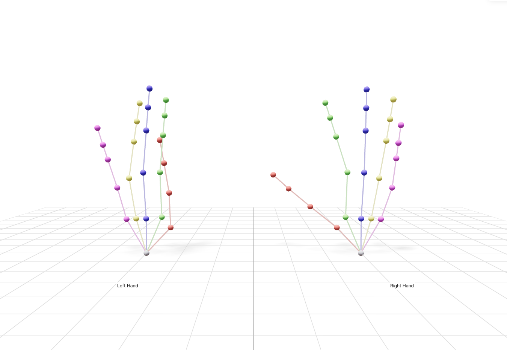

# Manus Glove ZMQ Interface

A ZMQ-based Manus glove server and client, used by the glove teleop
(`scripts/teleop.sh`, `isaac/teleop_isaac.py --source live`). Consists of:

1. **C++ ZMQ server** (`server/`) — reads from the MANUS SDK and publishes glove data over ZMQ at ~120 Hz
2. **Python client** (`manus_glove/`) — subscribes to ZMQ and provides a clean Python API

The full teleop walkthrough (hardware, calibration, recording takes) is in
[`docs/TELEOP.md`](../docs/TELEOP.md).

## Quick start (launcher scripts)

```bash
cd manus
./server.sh        # build-if-needed + run the ZMQ server (owns the glove)
./calibrate.sh     # in another terminal: skeleton calibration UI -> http://localhost:8080
```

`calibrate.sh` uses the `python` on your `PATH` (it needs `viser` + `pyzmq`; the Isaac Lab env
has both) and sets `PYTHONPATH` so `manus_glove` resolves to this copy — no pip install needed.
Override with `PYTHON=/path/to/python ./calibrate.sh`. Both scripts pass args through
(e.g. `./calibrate.sh --side left`, `./server.sh --pub-port 5555`).

## MANUS SDK (download separately)

The MANUS SDK is proprietary and is **not** included in this repository. Download the
MANUS Core SDK for Linux from MANUS (account required) and copy its `ManusSDK` folder here:

```
manus/ManusSDK/include/ManusSDK.h              (+ ManusSDKTypes.h, ManusSDKTypeInitializers.h)
manus/ManusSDK/lib/libManusSDK_Integrated.so
```

or keep it anywhere and export `MANUS_SDK_DIR=/path/to/ManusSDK` (`server.sh` and CMake both
read it; `manus/ManusSDK/` is git-ignored). The server runs the SDK in **integrated mode**
(`CoreSdk_InitializeIntegrated`), so no separate MANUS Core install is needed. We built and
ran it against the SDK of MANUS Core 3.1.1 (Core Integrated writes
`~/.config/Manus/Core 3/CoreLite.Settings.3.1.1.json`); file fingerprints of that SDK, so you
can tell whether yours is the same build:

| file | sha256 |
|---|---|
| `lib/libManusSDK_Integrated.so` | `0e67141b97b64c089c3bbdab47980ca9822c4de19adea810a2f68722adcb3fe3` |
| `include/ManusSDK.h` | `0beeec96f323c0bc87df707940f379f3dca0ec5b31bea9e49b90979ad7bb5b62` |

Other 3.x SDKs should work as long as they export the functions the server calls
(`grep -o "CoreSdk_[A-Za-z]*" server/src/*.cpp | sort -u`).

**License dongle.** The SDK license lives on the glove's USB **license dongle**, not on the
glove. With the glove alone the server logs `No compatible license found` and publishes
messages with an EMPTY skeleton and ergonomics; plug the dongle in (alongside the glove) and
restart the server. `isaac/teleop_isaac.py --source live` checks for exactly this before it
boots Isaac and tells you which of the two problems (no server / no license) you have.

## Hardware Setup

When connecting the Manus gloves, add the following udev rules (vendor 3325 = MANUS gloves and
dongles, 1915:83fd = the Nordic license dongle shipped with some gloves):

```bash
sudo tee /etc/udev/rules.d/70-manus-hid.rules << 'EOF'
# HIDAPI/libusb
SUBSYSTEMS=="usb", ATTRS{idVendor}=="3325", MODE:="0666"

# HIDAPI/hidraw
KERNEL=="hidraw*", ATTRS{idVendor}=="3325", MODE:="0666"

SUBSYSTEM=="usb", ATTR{idVendor}=="1915", ATTR{idProduct}=="83fd", MODE="0666", GROUP="plugdev"
EOF

sudo udevadm control --reload-rules && sudo udevadm trigger
```

## Prerequisites

- **MANUS SDK** — see above (`manus/ManusSDK/` or `MANUS_SDK_DIR`)
- **libzmq** — `sudo apt install libzmq3-dev`
- **CMake** >= 3.11, a C++17 compiler, `pkg-config`
- **Python** >= 3.8

## Building the C++ Server

`./server.sh` builds on first run. By hand:

```bash
cd server
cmake -S . -B build                                   # or: -DMANUS_SDK_DIR=/path/to/ManusSDK
cmake --build build -j$(nproc)
```

`nlohmann/json` and `cppzmq` are fetched automatically by CMake (needs internet on the first
configure). Configuring without the SDK stops with an error naming the expected files.

## Running the Server

```bash
cd server/build
./manus_zmq_server

# Custom ports
./manus_zmq_server --pub-port 5555 --haptic-port 5556 --control-port 5557
```

The server will:
1. Initialize the MANUS SDK in integrated mode
2. Search for and connect to a Manus host
3. Publish glove data as JSON over ZMQ PUB on port 5555
4. Listen for haptic commands on port 5556
5. Listen for calibration control commands on port 5557, and publish calibration
   status on the `manus_calibration` PUB topic

Only one process can own the glove: don't run MANUS Core (or a second server) at the same time.

## Installing the Python Client

```bash
cd manus   # this directory
pip install -e .
```

## Python Usage

```python
from manus_glove import ManusGlove

with ManusGlove(host="localhost") as glove:
    data = glove.get_data("right")
    if data:
        # Fingertip positions {finger_name: np.array([x,y,z])}
        tips = data.get_fingertip_positions()

        # All node positions (N, 3)
        positions = data.get_node_positions()

        # Ergonomics {name: value}
        ergo = data.get_ergonomics_dict()

        # Send haptic feedback
        glove.send_haptic(right_fingers=[0.5, 0.5, 0.0, 0.0, 0.0])
```

### Callback Mode

```python
def on_data(glove_data):
    print(f"{glove_data.side}: {len(glove_data.raw_nodes)} nodes")

with ManusGlove() as glove:
    glove.set_callback(on_data)
    # blocks until Ctrl-C
    import time
    while True:
        time.sleep(1)
```

## ZMQ Message Format

**Topics:** `manus_glove_left`, `manus_glove_right`

Each message is a two-frame ZMQ multipart: `[topic, json_payload]`.

JSON payload structure:
```json
{
    "glove_id": 12345,
    "side": "Right",
    "timestamp": 1234567890.123,
    "raw_nodes": [
        {
            "node_id": 0,
            "parent_node_id": -1,
            "joint_type": "MCP",
            "chain_type": "Hand",
            "position": [0.1, 0.2, 0.3],
            "orientation": [0.0, 0.0, 0.0, 1.0]
        }
    ],
    "ergonomics": [
        {"type": "IndexDIPStretch", "value": 0.5}
    ],
    "raw_sensors": {
        "orientation": [0.0, 0.0, 0.0, 1.0],
        "sensors": [
            {"position": [0.1, 0.2, 0.3], "orientation": [0.0, 0.0, 0.0, 1.0]}
        ]
    }
}
```

## Examples

```bash
# Print live glove data
python examples/print_glove_data.py

# Print fingertip positions only, right hand
python examples/print_glove_data.py --tips --side right

# Print ergonomics at 10Hz
python examples/print_glove_data.py --ergo --hz 10

# Connect to remote machine
python examples/print_glove_data.py --host 192.168.1.100

# Visualize hand keypoints in 3D (opens browser at localhost:8080)
python examples/visualize_hand.py

# Visualize right hand only, custom ports
python examples/visualize_hand.py --side right --host 192.168.1.100 --viser-port 9090

# Interactive calibration with live 3D hand (see "Glove Calibration" below)
python examples/calibrate_hand.py --side right
```



## Glove Calibration

Calibration runs **inside the server** (the single owner of the Manus device);
Python drives it over the control socket and visualizes it. The actual SDK calls
(`CoreSdk_GloveCalibrationStart` / `StartStep` / `Finish`) execute in the C++
process — they cannot be reached over ZMQ from a non-owning process.

### Interactive UI (recommended)

A viser app shows the **live 3D hand** alongside the step instructions, a
countdown, and Start / Next / Abort / Save buttons:

```bash
# 1. Start the server (owns the device)
./server/build/manus_zmq_server

# 2. Launch the calibration UI, then open the printed http://localhost:8080
python examples/calibrate_hand.py --side right
```

For timed steps the UI auto-advances when the countdown elapses. For continuous
steps (the SDK reports a negative duration), hold the pose and press **Next →**.

### Programmatic control

```python
from manus_glove import ManusCalibration

with ManusCalibration(host="localhost") as calib:
    calib.start("right")
    while True:
        s = calib.get_status()
        if s and s.manual:
            input("Hold the pose, press Enter...")
            calib.next()
        if s and s.is_terminal:
            print(s.message)   # "Calibration complete" / error text
            break

    # Optionally persist / restore the calibration (path is server-side):
    calib.save("calibration_right.bin", side="right")
    calib.load("calibration_right.bin", side="right")
```

### Calibration status topic

**Topic:** `manus_calibration` (on the same PUB port as glove data).

```json
{
    "state": "running_step",
    "side": "right",
    "glove_id": 12345,
    "step_index": 2,
    "num_steps": 6,
    "title": "Flat hand",
    "description": "Place your hand flat on the table",
    "step_time": 3.0,
    "remaining": 1.4,
    "manual": false,
    "message": "Hold the pose"
}
```

`state` is one of `idle`, `preparing`, `running_step`, `waiting_user`,
`finishing`, `done`, `aborted`, `error`.

### Control commands (PUSH → server control port 5557)

```json
{"cmd": "start", "side": "right"}
{"cmd": "next"}
{"cmd": "abort"}
{"cmd": "save", "side": "right", "path": "calibration_right.bin"}
{"cmd": "load", "side": "right", "path": "calibration_right.bin"}
```

## Haptic Feedback

Send haptic commands from Python (5 floats per hand, 0.0–1.0):

```python
glove.send_haptic(
    left_fingers=[0.5, 0.5, 0.0, 0.0, 0.0],   # thumb, index, middle, ring, pinky
    right_fingers=[0.0, 0.0, 0.5, 0.5, 0.5],
)
```

The server forwards these to `CoreSdk_VibrateFingersForGlove`.
